<a href="https://jeremie.roberrini.com">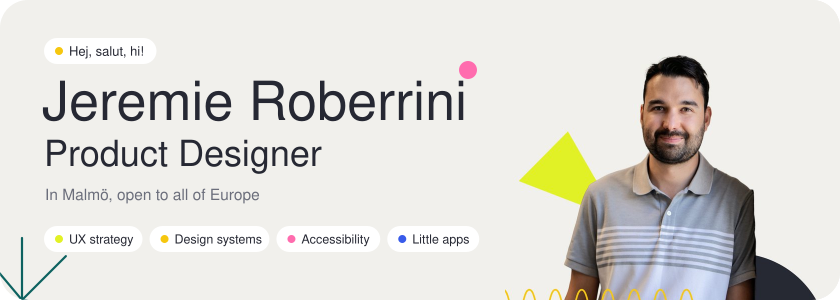</a>

### Hi, I'm Jeremie 👋

I'm a French product designer living in Malmö. I spend my days turning knotty B2B problems (international payments, sustainability reporting, software licensing, industrial machines) into tools people actually enjoy using, with accessibility built in from the start.

After hours I dance salsa and kizomba, run by the sea, cook spicy food for friends, and build small, calm apps for myself and anyone else who wants them.

This repo is my front door: portfolio, side projects, CV, and a bit about me.

 

## ✦ Start here

<a href="https://jeremie.roberrini.com">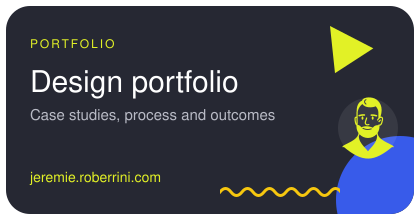</a>
<a href="https://jeremie.roberrini.com/commonplace">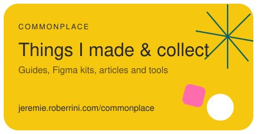</a>

## ✦ Case studies

<a href="https://jeremie.roberrini.com/projects/gigapay-international-payments">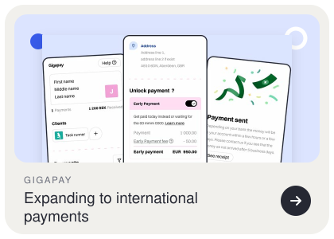</a>
<a href="https://jeremie.roberrini.com/projects/position-green-product-vision">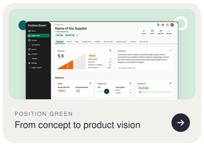</a>
<a href="https://jeremie.roberrini.com/projects/snow-software-cloud-self-service">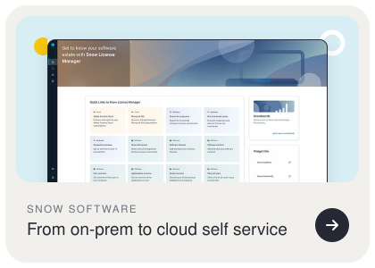</a>
<a href="https://jeremie.roberrini.com/projects/nederman-industrial-hmi">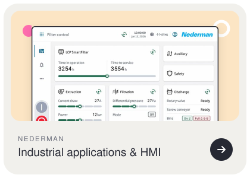</a>
<a href="https://jeremie.roberrini.com/projects/gigapay-customer-workflows">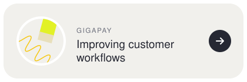</a>
<a href="https://jeremie.roberrini.com/projects/gigapay-design-system">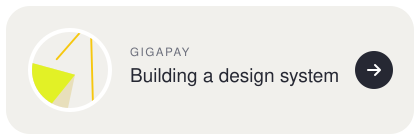</a>
<a href="https://jeremie.roberrini.com/projects/beikos-clinical-test">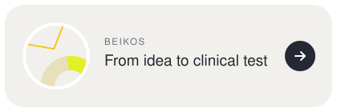</a>
<a href="https://jeremie.roberrini.com/projects">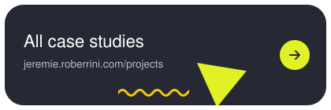</a>

## ✦ Little apps I made

Small, calm, private by default. No ads, no tracking, no accounts unless you want one.

<a href="https://roberrini.com/okay-weather">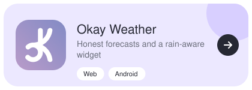</a>
<a href="https://roberrini.com/sundial">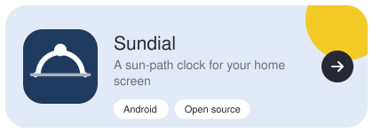</a>
<a href="https://roberrini.com/workout-journal">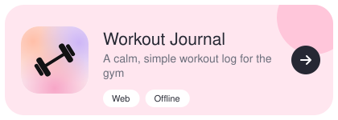</a>
<a href="https://roberrini.com/grateful">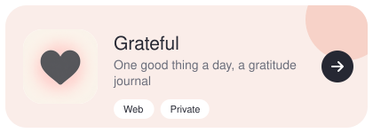</a>
<a href="https://roberrini.com/little-stories">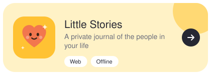</a>
<a href="https://nts-downloader.lovable.app/">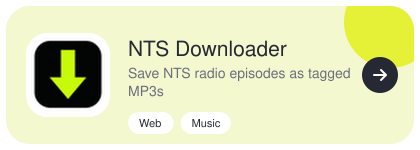</a>
<a href="https://cv-makover.lovable.app/">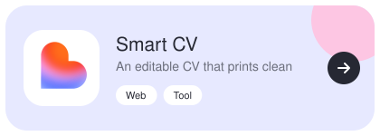</a>
<a href="https://roberrini.com">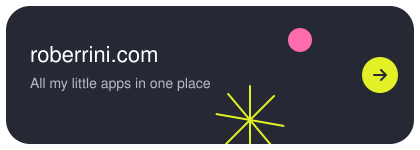</a>

Source code: [Okay Weather](https://github.com/Jeremie-R/OkayWeatherAi) · [Sundial](https://github.com/Jeremie-R/sundial-widget) · [Workout Journal](https://github.com/Jeremie-R/WorkoutJournal) · [Grateful](https://github.com/Jeremie-R/Grateful-Journal) · [Little Stories](https://github.com/Jeremie-R/LittleStories)

## ✦ In this repo

<a href="about-me.md">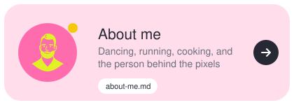</a>
<a href="photos/">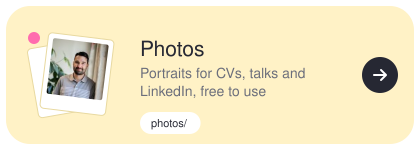</a>
<a href="cv/">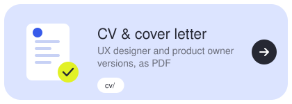</a>
<a href="links.md">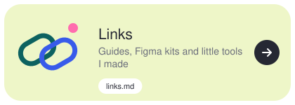</a>

## ✦ Say hi

<a href="https://dribbble.com/JeremieRN">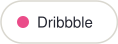</a>
<a href="https://www.behance.net/jeremieroberri">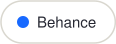</a>
<a href="https://www.figma.com/@jeremieroberrin">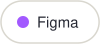</a>

<a href="https://lovable.dev/@jeremie_roberrini">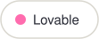</a>

Or just write to **[jeremie@roberrini.com](mailto:jeremie@roberrini.com)**. I'm always up for a coffee and a chat about your product.
