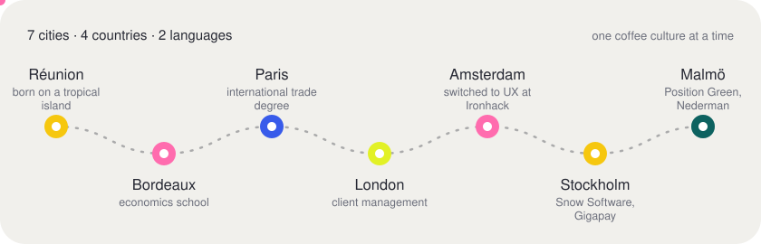
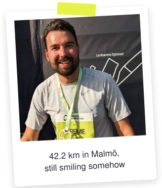
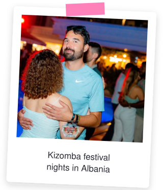
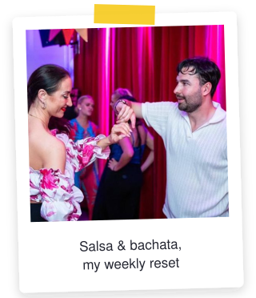
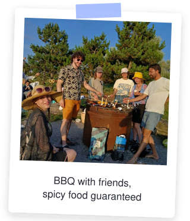
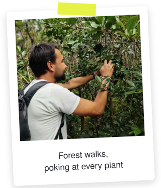
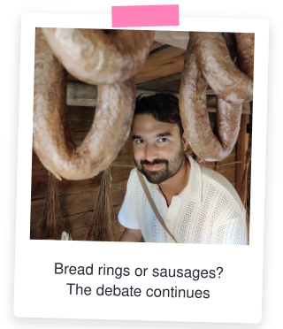
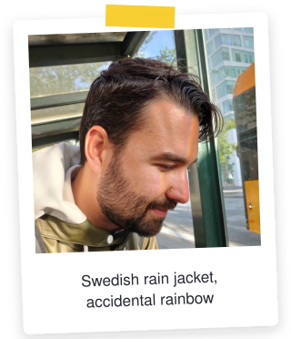
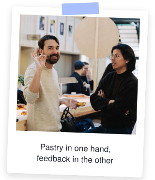
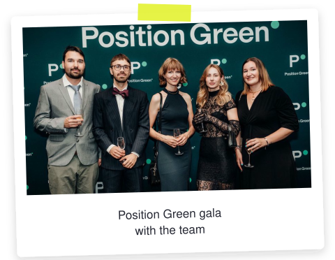

  

<h1 align="center">About me</h1>

  Product designer · dancer · runner · home cook 
  Born on Réunion, living in Malmö, with Copenhagen just across the bridge

 

Salut! I'm Jeremie. I design digital products that make people's days a little simpler, and I care a lot about doing it in a way that works for everyone, including people who use a screen reader, a keyboard or a tired brain at 5pm.

I didn't start in design. I studied economics and international trade, then spent a few years in client management and customer service in London and Amsterdam. Listening to frustrated customers all day turned out to be great UX training. In 2020 I retrained at Ironhack Amsterdam, and since then I've designed for startups and scale-ups in fintech, health tech, sustainability, software licensing and industrial machinery.

## ✦ The short version

- 🏝️ **Born on Réunion**, a small French island in the Indian Ocean (yes, the one with the active volcano)
- 💼 **5 years in product design**: Beikos, Leikir, Snow Software, Gigapay, Position Green, Nederman
- 🧩 **What I'm good at**: untangling complex B2B flows, design systems, accessibility, and getting product, tech and business to agree on the next step
- 🗣️ **Languages**: French and English
- 🛠️ **Tools**: Figma every day, plus Notion, Jira, Hotjar, Mixpanel and Maze. HTML, CSS, JS and React when I want to make something real
- 🤖 **Lately**: building small apps end to end with AI as my pair programmer, from the first sketch to a working app on my phone

## ✦ Where I've lived

Every move came with a new way of doing things. Moving around taught me that there's rarely one right way to work, which is a useful thing to remember in a design critique.

## ✦ Off the screen

**Things that make me happy**

- 💃 **Salsa, bachata and kizomba**, a few evenings a week, and a festival whenever I can get to one
- 🏃 **Running by the sea** in Malmö, and one full marathon (so far)
- 🧖 **Sauna**, the most Scandinavian thing about me
- 🚲 **Biking** everywhere around the city
- 🌶️ **Cooking for friends**, spicy dishes and summer BBQs
- 🎶 **Live music**, concerts and NTS Radio on repeat
- 🏛️ **Museums, forests and new cities**, ideally all in the same weekend
- ✏️ **Drawing**, some of it ends up on [Instagram](https://www.instagram.com/jeremie_draws/)

 

## ✦ At work

I'm happiest in a small product trio, with a product owner and developers, where design isn't a hand-off but part of the conversation from day one. I like to start with the messy part (talking to customers, mapping the journey, finding where people actually get stuck) and then make it simple, testable and consistent with a solid design system.

**Kind words from people I've worked with**

> Jeremie is so knowledgeable when it comes to product design, I feel like I've learned so much!
>
> — **Maïa Foulis**, UX Writer at Position Green

> He uncovers real customer pain points and turns them into intuitive, meaningful solutions. He brings a strong critical sense and isn't afraid to challenge assumptions.
>
> — **Marie Distinguin**, Product Manager at Snow Software

> A reliable and engaged teammate who brought a strong attention to detail and delivered design work quickly, even under time pressure.
>
> — **Nhan Ngo**, Product Manager at Position Green

> He loves to help other people by giving them tips and pointers on how to use several design tools!
>
> — **Amir Aran**, my UX teacher at Ironhack

## ✦ Say hi

I'm open to product design roles across Europe, and always up for a coffee.

📮 [jeremie@roberrini.com](mailto:jeremie@roberrini.com) · 💼 [LinkedIn](https://www.linkedin.com/in/jeremieroberrini/) · 🎨 [Portfolio](https://jeremie.roberrini.com)

 

[← Back to the main page](README.md)
