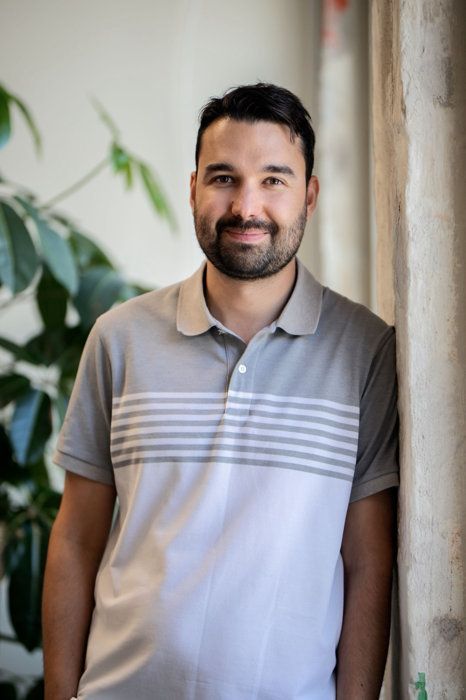
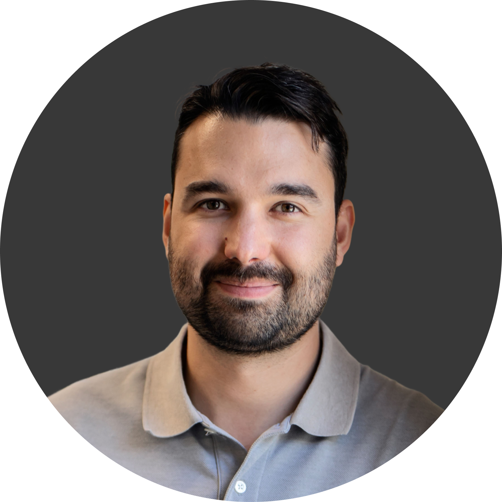
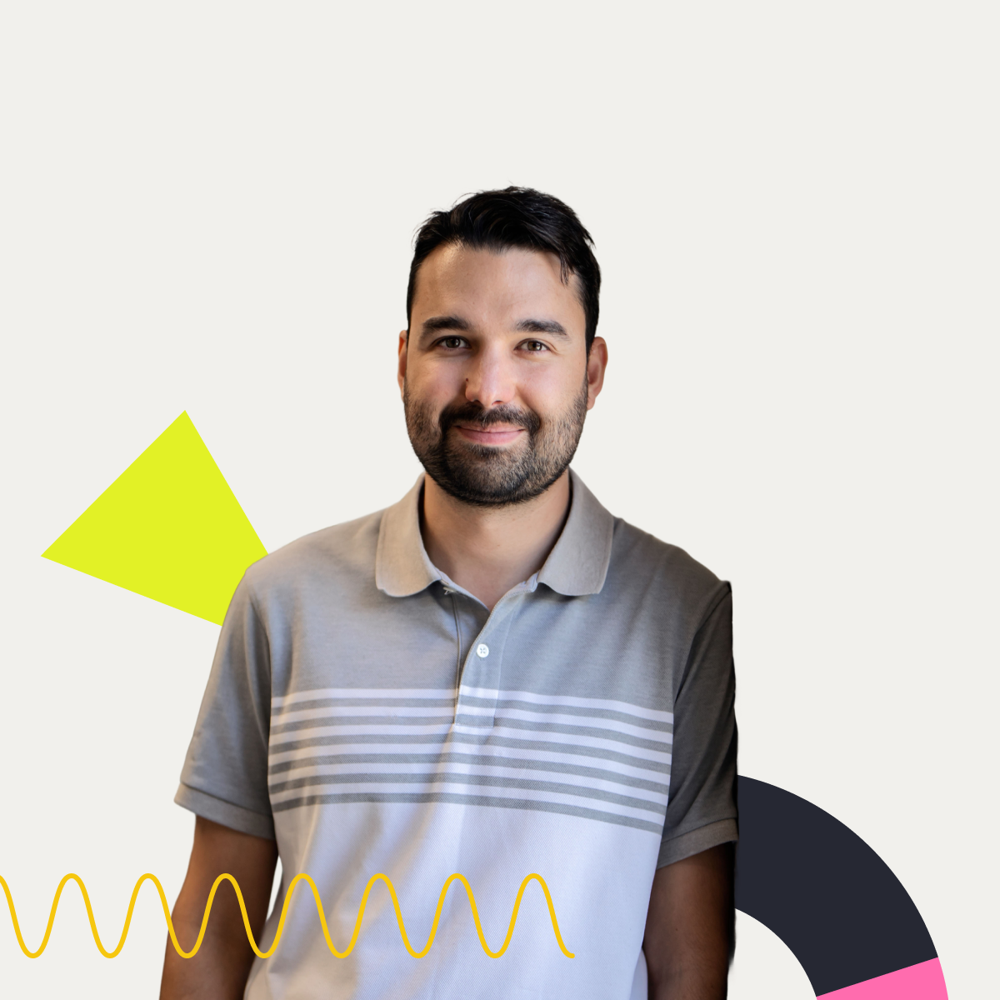

# 📸 Photos

Portraits I use for my CV, LinkedIn and speaker pages.
Feel free to use them for an event page, an article or an intro. Click a photo to open the full-size file.

| File | Best for | Size |
| --- | --- | --- |
| [`jeremie-roberrini-portrait.jpg`](jeremie-roberrini-portrait.jpg) | Articles, event pages, press | 1333 × 2000 |
| [`jeremie-roberrini-headshot-round.png`](jeremie-roberrini-headshot-round.png) | CV, LinkedIn, avatars | 1600 × 1600 |
| [`jeremie-roberrini-cutout.png`](jeremie-roberrini-cutout.png) | Portfolio-style intros, social posts | 1200 × 1200 |

 

[← Back to the main page](../README.md)
